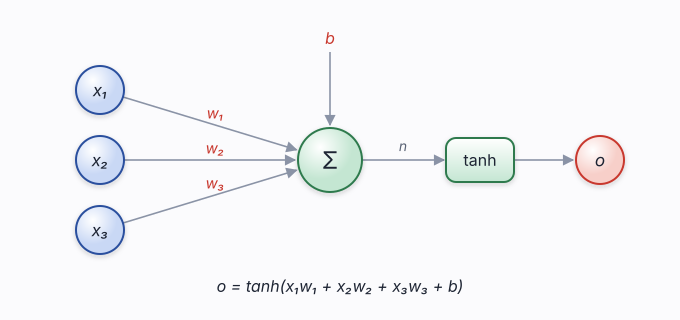
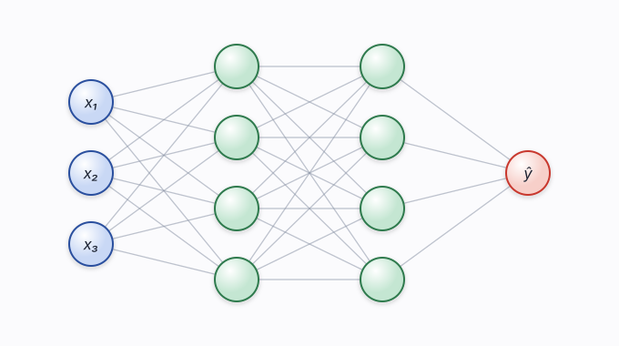

# L1: Building Micrograd

Micrograd 是一个标量自动求导引擎，只处理单个数字，封装了一个 `Value` 类实现简单的前向传播和反向传播。还可以通过调用 `graphviz` 库实现了神经元的可视化、封装 `MLP` 来实现一个简单的神经网络训练。

## 神经网络

神经网络是一种深度学习的方法，也是机器学习的一种。神经网络通过现有的学习资料，来训练一个可以计算预测结果的模型，是一个带参数的函数。神经网络由许多神经元组成，神经元排列的方式就是神经网络的架构，例如 MLP, CNN 和 Transformer 都是神经网络的不同架构。

一个神经元表达式为：$o=act(x_1w_1+x_2w_2+...+x_nw_n+b)$ ，先是线性的加权求和，再是一个非线性函数的激活。
激活函数在灵感上来源于生物神经元，控制输出范围，而且还能引入非线性，赋予网络拟合复杂函数的能力，如 Relu、tanh 和 Softax 。



在神经网络构建过程中，如何选择输入、如何定义损失函数、构建怎样的网络、训练多大参数的网络都是决定最终效果的关键因素。

现构建一个简单的 MLP 神经网络，输入是 $(x_1, x_2, x_3)$，输出则是一个预测值 $y$ 。事实上 $y$ 在一定程度上与 $(x_1, x_2, x_3)$ 存在某些无法用简单函数表达的关联，但是可以用海量的现有数据来进行拟合，所以神经网络的目标是让 $loss = \sum(\hat{y}-y)^2$ 尽可能地小。而让损失变小的唯一方法就是修改函数的参数（也就是 W 和 B 两个张量），这就是训练的过程。而调参的过程，通常采用梯度下降法来完成。

## 梯度下降法

一元函数 $f(x)$ 的导数的定义：$\displaystyle \frac{df}{dx} = f'(x)=\lim_{h\rightarrow0}\frac{f(x+h)-f(x)}{h}$ 。

多元函数 $f(x_1, x_2...x_n)$ 的梯度，即导数的一般情况的定义：$\displaystyle \nabla f = (\frac{\partial f}{\partial x_1},\frac{\partial f}{\partial x_2}...\frac{\partial f}{\partial x_n})$ 。

梯度的性质：函数的值在某点沿着梯度的方向上升，导数的正负代表方向，大小代表变化率。

对于复杂一个多元函数，比如神经网络 $L(\theta)$ 来说，想要找到一个最低点并不容易。可以利用梯度的性质来逐步调整参数以减小损失，即把所有的参数 $\theta$ 都往梯度的反方向走一段（$\eta$ 是学习率，决定了一步走多长）：
$$
\theta_{t+1} = \theta_t - \eta \nabla J(\theta_t)
$$
实际过程中可能遇到步长太大、循环次数过少/过多，导致损失率降不下来。所以调参同样没有统一的万能标准。反复使用梯度下降法，最终可以得到一个相对理想的损失，得到的参数就是训练的结果。

## Value 类型

Micrograd 仅使用了 100 行左右就实现了一个简单的标量反向传播的引擎。

反向传播就是从根结点 $L$ 起计算每一个参数的梯度的过程，利用了链式求导法则，即：
$$
\displaystyle \frac{\partial f}{\partial x} = \frac{\partial f}{\partial a_1} \frac{\partial a_1}{\partial a_2}...\frac{\partial a_n}{\partial x}+\frac{\partial f}{\partial b_1} \frac{\partial b_1}{\partial b_2}...\frac{\partial b_n}{\partial x}+...+\frac{\partial f}{\partial k_1} \frac{\partial k_1}{\partial k_2}...\frac{\partial k_n}{\partial x}
$$
其中有几个实现的关键点：

1. 反向传播前，梯度需要清零，不然会不停累加
2. 不同的操作符的反向传播函数均不同，这里采用闭包的方式储存并赋值
3. 乘法交换梯度，加法原样复制
4. 拓扑排序保证处理一个节点之前，所有用到它的节点都已经把梯度传给它了。

反向传播函数同样具备一个性质：可以是任意层次的封装，即简单的加法可以封装为一个反向传播，复杂的 $\tanh$ 同样也可以只封装为一个反向传播。区别就是整体求导和局部求导，最后每个参数的梯度都是一致的。

## MLP 构建



首先 n 个 `Value` 节点和 n 个 w 、一个 b 经过激活函数构成了  `Neuron`；

其次 m 个不同的 `Neuron` （共用一组 `Value` 输入）构成一个 `Layer` ；

最后 p 个不同的 Layer （使用第一组 `Value` 输入），构成一个 `MLP`。

在课程的例子中，MLP 是 3-4-4-1 形状的，也就是三个输入对应一个预测输出，一共有 12 + 16 + 4 + 9 = 41 个参数。

在这个 MLP 上反复执行前向传播和反向传播，再根据梯度修改参数，就可以**训练模型**，得到理想的参数。

## Torch 的写法

PyTorch 是主流的深度学习框架，提供高度封装但是灵活的模块，基础数据结构是 Tensor（张量）。它在用法上非常类似于 NumPy 的多维数组（ndarray），但最大的优势在于支持在 GPU/TPU 等硬件加速器上进行高速并行计算。

Micrograd 正是模仿了 PyTorch 的 API，虽然简单，但是可以取得一样的效果。

```python
import torch

def try_torch():
    x1 = torch.Tensor([2.0]).double()
    x1.requires_grad = True # PyTorch 默认元素是不求梯度的

    x2 = torch.Tensor([0.0]).double()
    x2.requires_grad = True

    w1 = torch.Tensor([-3.0]).double()
    w1.requires_grad = True

    w2 = torch.Tensor([1.0]).double()
    w2.requires_grad = True

    b = torch.Tensor([6.88137358]).double()
    b.requires_grad = True

    n = x1*w1 + x2*w2 + b
    o = torch.tanh(n)

    print(o.data.item())
    o.backward() # 反向传播
```

